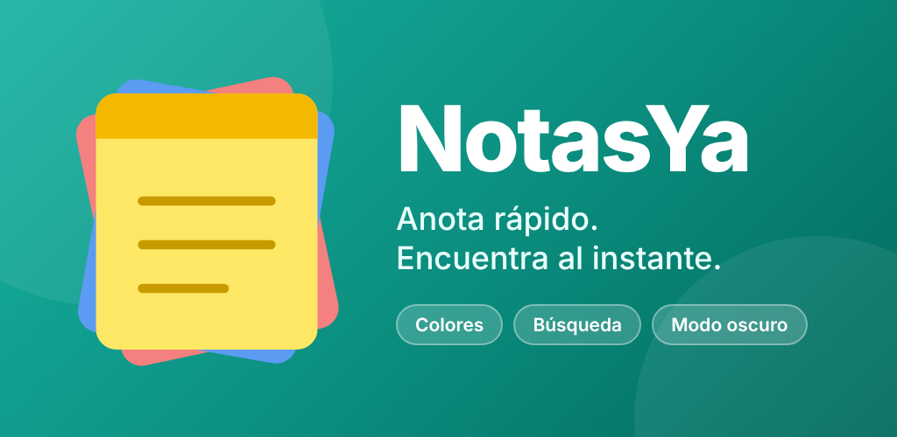

  

<h1 align="center">NotasYa</h1>

<strong>Anota rápido. Encuentra al instante.</strong>

NotasYa es una app de notas para Android, pensada para anotar sin vueltas y encontrar después lo que escribiste.

## Qué hace

- **Notas de colores.** Cada nota tiene su color, y puedes ordenarlas por color, por fecha de modificación, por fecha de creación o por título.
- **Título opcional.** Si no le pones título, la nota usa su primera línea.
- **Cuatro vistas de la lista:** lista, detalles, retícula y retícula grande.
- **Búsqueda rápida.** Encuentra tus notas sin importar las tildes ni las mayúsculas, y guarda tu historial de búsquedas.
- **Archivo y papelera.** Archiva lo que no usas a diario. Lo que mandas a la papelera se puede recuperar durante 30 días.
- **Modo claro y oscuro,** o el mismo del celular, y tamaño de letra a tu gusto.
- **Enlaces, correos y teléfonos** que se pueden tocar dentro de la nota.
- **Se guardan en tu celular.** Las notas no se envían a ningún servidor.

## Descarga

Disponible gratis en **[Google Play](https://play.google.com/store/apps/details?id=com.jluismp.notasya)**. Las versiones antiguas en *Releases* ya no se actualizan.

## Anuncios

La versión gratuita muestra un banner pequeño de publicidad de [Google AdMob](https://admob.google.com) al final de la lista de notas, y nunca dentro de una nota. Se pueden desactivar en Ajustes.

## Privacidad

Tus notas se quedan en tu celular. Lee la [política de privacidad](docs/privacidad.html) para saber qué hace la publicidad y cómo borrar tus datos.

## Imágenes

Están en la carpeta [`docs/imagenes`](docs/imagenes).

---

Este repositorio solo contiene la información de la app y sus descargas. El código fuente es privado.
